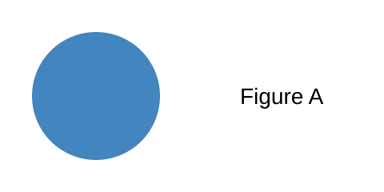

# Introduction

Synaptic dysfunction is an early feature of disease [@hanse2013]. Two studies agree [@villette2019; @hanse2013], and a run of them too [@hanse2013; @villette2019; @bellesi2013; @pnas2018]. As shown by @bellesi2013, the effect is local^[Measured in synaptosomes [@guo2020].]. Missing [@nosuchkey].

# Results

## Sleep raises APP

Panels (@fig-a-b,c) and a range (@fig-a-a-c) and one panel (@fig-a-b).

{#fig-a width=60%}

Supplementary support (@fig-s1).

# Discussion

Preprints [@kapoor2022] and books [@alcock2006; @king2003].

# Limitations of the study

Sample sizes were small.

# Methods

## Animals

Mice were housed singly [@dueck2009].

## Statistical analysis

We used ANOVA [@hao2014; @wilson2023].

# Data availability

Data are on figshare.

# Code availability

Code is on Zenodo [@online2026].

# Acknowledgements

We thank the lab.

# Funding

NIH grant R01 (R.F.).

# Author contributions

A.L. and G.H. did the work.

# Competing interests

The authors declare no competing interests.

# References
